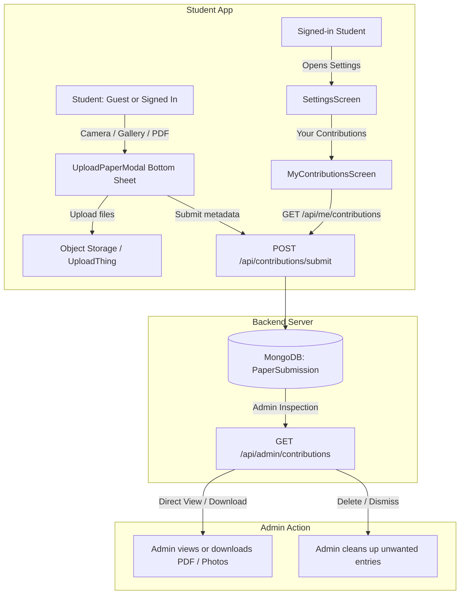

# Software Requirements Specification (SRS): User Question Paper Contributions & Contributor Panel

Structured after IEEE Std 830-1998 (Recommended Practice for Software Requirements Specifications).

| Field | Value |
|---|---|
| Product | PyQdeck mobile app (`pyqdeck-expo`) + PyQdeck backend (`server`) |
| Version of product | 1.13.0 (`package.json`, `app.json`) |
| Document version | 1.0 (approved specification) |
| Date | 2026-10-14 |
| Status | Approved specification |
| Audience | Product owner, mobile developers, backend developers, QA |

Requirement IDs: `FR-CONTRIB-` functional, `NFR-CONTRIB-` non-functional, `IR-CONTRIB-` interface, `CR-CONTRIB-` constraint. Priority uses MoSCoW (M = must, S = should, C = could).

---

## 1. Introduction

### 1.1 Purpose

This specification defines the crowdsourced **Exam Question Paper Contribution System** for PyQdeck. It enables students (both anonymous guests and signed-in users) to submit past exam papers via photos or PDF documents, gives signed-in students a dedicated **"Your Contributions"** tracking panel in Settings, and provides administrators with a direct view/download inspection pipeline to approve or reject submitted papers.

### 1.2 Scope

In scope:
- **Student Upload Flow (`pyqdeck-expo`)**:
  - Non-intrusive bottom sheet UI accessible from Home and Question List screens.
  - Optional Exam Year (numeric text input) and optional Subject Name.
  - Multi-file image capture (Camera / Gallery) and single/multi-page `.pdf` document picking (`expo-document-picker`).
  - Anonymous (guest) and signed-in contribution support without authentication walls.
- **Contributor Tracking Panel (`pyqdeck-expo`)**:
  - Settings screen entry: "Your Contributions" available to signed-in accounts.
  - Dedicated `MyContributionsScreen` displaying submission history, status badges (`Pending`, `Approved`, `Rejected`), and submission details.
  - Guest prompt in Settings: *"Sign in to track your contributed papers"*.
- **Backend & Storage (`server`)**:
  - Dedicated object storage (UploadThing / S3-compatible storage) for quarantined user-uploaded raw files (PDFs and image sets).
  - MongoDB `PaperSubmission` schema with contributor identity tracking and file URLs.
  - Client contribution submission endpoint (`POST /api/contributions/submit`) and personal history endpoint (`GET /api/me/contributions`).
- **Admin Inspection & Download**:
  - Admin inspection list (`GET /api/admin/contributions`) allowing direct viewing and downloading of submitted PDFs or images.
  - Ability for admins to delete or dismiss processed/unneeded submissions.

Out of scope for this initial revision:
- Automatic conversion or promotion into `PaperAsset` (admins download and curate papers manually).
- On-device optical character recognition (OCR) or automatic question transcription into typed database questions.
- User-to-user public comment threads on submissions.
- Complex gamification or karma token exchanges.

### 1.3 Definitions and Acronyms

| Term | Meaning |
|---|---|
| Contributor | Any student who submits an exam question paper (guest or signed-in). |
| Paper Submission | A user-uploaded paper record containing raw PDF or image URLs, stored in staging. |
| Object Storage | Isolated file storage (UploadThing / S3 / R2) storing raw incoming user files. |
| Received | Submission successfully stored and available for admin download. |

---

## 2. Overall Description

### 2.1 Product Perspective

Historically, PyQdeck question papers were curated and uploaded solely by platform administrators via an internal admin sheet (`ManagePaperSheet.tsx`). When an exam year or subject lacked coverage, students faced an empty state with no recourse.

The User Contribution system opens a frictionless intake funnel:
1. **Intake**: Any student can upload camera photos, gallery pictures, or a PDF with minimal required friction (fields are optional; file attachment is mandatory).
2. **Quarantine & Storage**: Raw student files land in dedicated object storage (UploadThing / S3), completely isolated from production paper assets.
3. **Personal Transparency**: Signed-in students see their submissions real-time in a "Your Contributions" panel inside the Settings screen.
4. **Admin Inspection**: Administrators directly view and download incoming submissions to use/check whenever needed.

### 2.2 User Classes and Permissions

| Class | Upload Capability | Contribution Tracking | Admin Action |
|---|---|---|---|
| **Anonymous Guest** | Yes (no login barrier). | No (sees nudge to sign in to save history). | None |
| **Signed-in Student** | Yes (tied to Clerk user ID). | Full ("Your Contributions" panel in Settings). | None |
| **Administrator** | Yes. | Full. | View, download, delete submissions. |

---

## 3. Specific Requirements

### 3.1 Upload Bottom Sheet (`pyqdeck-expo`)

| ID | Priority | Requirement |
|---|---|---|
| `FR-CONTRIB-1` | M | The app SHALL provide a bottom sheet (`UploadPaperModal.tsx`) sliding up from the bottom of the screen with a top drag handle, responsive dialog constraints, and safe area insets. |
| `FR-CONTRIB-2` | M | Both anonymous guests and signed-in students SHALL be permitted to open and submit the bottom sheet without forced authentication gates. |
| `FR-CONTRIB-3` | M | The bottom sheet SHALL request only two input fields: **Exam Year** (numeric keyboard, max 4 digits) and **Subject Name** (text input). Both fields SHALL be explicitly marked and treated as `Optional`. |
| `FR-CONTRIB-4` | M | If opened from a specific subject screen, the Subject Name and selected Year SHALL be pre-filled automatically while remaining editable. |
| `FR-CONTRIB-5` | M | The bottom sheet SHALL provide three attachment action cards: **Camera** (`ImagePicker.launchCameraAsync`), **Gallery** (`ImagePicker.launchImageLibraryAsync`), and **PDF File** (`DocumentPicker.getDocumentAsync` for `application/pdf`). |
| `FR-CONTRIB-6` | M | At least one paper file (image or PDF) SHALL be required to submit. Submitting without attachments SHALL display an informative alert. |
| `FR-CONTRIB-7` | M | Selected files SHALL be displayed in an attached files list with thumbnails, file type badges, file size calculations, and individual delete buttons. |
| `FR-CONTRIB-8` | M | The bottom sheet SHALL wrap its content inside a `KeyboardAvoidingView` ensuring focused inputs remain visible across both iOS and Android without window clipping. |
| `FR-CONTRIB-9` | M | The "Upload Exam Paper" entry card on `HomeScreen.tsx` and button on `QuestionListScreen.tsx` SHALL NOT be rendered during initial data loading states (`!loading`). |
| `FR-CONTRIB-10` | M | The vertical gap between the Home screen's upload card and the "Browse all subjects" button SHALL be compact (10px margin). |

### 3.2 Contributor Panel in Settings (`pyqdeck-expo`)

| ID | Priority | Requirement |
|---|---|---|
| `FR-CONTRIB-11` | M | When a user is signed in, `SettingsScreen.tsx` SHALL render a **"Your Contributions"** row featuring an icon (`upload-cloud`), count badge (if submissions exist), and navigation arrow. |
| `FR-CONTRIB-12` | M | Tapping the row SHALL navigate to `MyContributionsScreen`, fetching the student's submission history via `GET /api/me/contributions`. |
| `FR-CONTRIB-13` | M | `MyContributionsScreen` SHALL render each contribution card with: Subject Title, Exam Year, Submission Date, File Type summary (e.g., *"PDF document"* or *"4 scanned pages"*), and a status pill indicating *"Uploaded"*. |
| `FR-CONTRIB-14` | M | If the user has made zero submissions, `MyContributionsScreen` SHALL show a welcoming empty state encouraging them to contribute exam papers with a direct "Upload Paper" button. |
| `FR-CONTRIB-15` | S | `MyContributionsScreen` SHALL support pull-to-refresh (`RefreshControl`) to refetch submission history. |
| `FR-CONTRIB-16` | M | When a user is signed out, the "Your Contributions" settings row SHALL render a subtle sign-in prompt (e.g. *"Sign in to track paper contributions"*), navigating to the sign-in sheet on press. |

### 3.3 Backend API & Storage (`server`)

| ID | Priority | Requirement |
|---|---|---|
| `FR-CONTRIB-17` | M | The backend SHALL store submissions in a dedicated MongoDB collection `PaperSubmission`: `contributorClerkId` (sparse string), `contributorEmail` (string), `isAnonymous` (boolean), `subjectName` (string), `year` (number), `fileType` (`pdf` or `images`), `fileUrls` (array of strings), timestamps. |
| `FR-CONTRIB-18` | M | Raw user-uploaded files SHALL be stored in dedicated object storage (UploadThing / S3 / R2), keeping user uploads isolated from production assets. |
| `FR-CONTRIB-19` | M | The backend SHALL provide `POST /api/contributions/submit`: open to both anonymous requests and authenticated requests (associating Clerk user ID if present). |
| `FR-CONTRIB-20` | M | The backend SHALL provide `GET /api/me/contributions`: protected by `requireSignIn`, returning only the authenticated user's submissions sorted by `createdAt: -1`. |
| `FR-CONTRIB-21` | M | The backend SHALL provide admin routes under `adminAppRoutes.js`: `GET /admin/contributions` (list all submissions) and `DELETE /admin/contributions/:id` (delete/dismiss submission). |

### 3.4 Admin Inspection & Download

| ID | Priority | Requirement |
|---|---|---|
| `FR-CONTRIB-22` | M | Administrators SHALL be able to view and download submitted PDFs or full-resolution images directly from the admin dashboard or in-app admin tools. |
| `FR-CONTRIB-23` | M | Administrators SHALL be able to delete or dismiss submissions from the list once downloaded or handled. |

---

## 4. Non-Functional Requirements

| ID | Metric | Requirement |
|---|---|---|
| `NFR-CONTRIB-1` | Performance | Opening the upload bottom sheet SHALL be instantaneous with zero lag or frame drops. |
| `NFR-CONTRIB-2` | Resiliency | If a file upload network error occurs, the user's entered form values (Subject and Year) SHALL be preserved so they do not need to retype them. |
| `NFR-CONTRIB-3` | Storage Safety | User uploads must remain isolated in dedicated object storage without mutating production papers. |
| `NFR-CONTRIB-4` | Compatibility | Bottom sheet MUST adapt responsively: full-width sheet on mobile phones and centered modal dialog on tablets/desktops (`useDialogLayout`). |

---

## 5. Traceability Matrix

| Requirement | Implementation Artifact | Target Component |
|---|---|---|
| `FR-CONTRIB-1` - `FR-CONTRIB-8` | `pyqdeck-expo` | [`UploadPaperModal.tsx`](file:///D:/projects/pyqdeck/pyqdeck-expo/src/components/UploadPaperModal.tsx) |
| `FR-CONTRIB-9` - `FR-CONTRIB-10` | `pyqdeck-expo` | [`HomeScreen.tsx`](file:///D:/projects/pyqdeck/pyqdeck-expo/src/screens/HomeScreen.tsx), [`QuestionListScreen.tsx`](file:///D:/projects/pyqdeck/pyqdeck-expo/src/screens/QuestionListScreen.tsx) |
| `FR-CONTRIB-11` - `FR-CONTRIB-16` | `pyqdeck-expo` | `SettingsScreen.tsx`, `MyContributionsScreen.tsx` |
| `FR-CONTRIB-17` - `FR-CONTRIB-20` | `server` | `server/models/PaperSubmission.js`, `server/routes/contributionRoutes.js` |
| `FR-CONTRIB-21` - `FR-CONTRIB-23` | `server` + `pyqdeck-expo` | `server/routes/adminAppRoutes.js`, `AdminContributionsScreen.tsx` |
